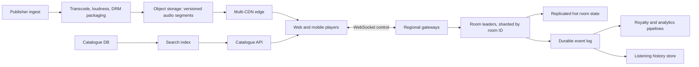
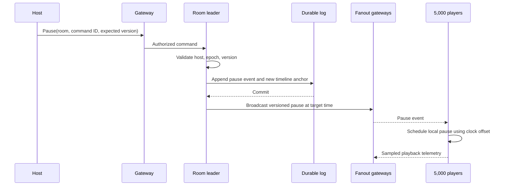

# Listen Together: backend design

## Scale and core decision

For 20 million monthly users, 2 million concurrent listeners, 50 million tracks, and 200,000 active rooms, audio should never pass through room servers. Clients fetch encrypted adaptive audio segments from a CDN. Room services send only control events and a shared timeline. At 2 million listeners and a rough 160 kb/s average, audio egress is about 320 Gb/s before overhead, so multi-CDN delivery and regional cache capacity are central concerns. The figure is a planning estimate, not a benchmark.

## Delivery, catalogue, and data

Publisher ingest validates rights and metadata, stores immutable masters, transcodes multiple bitrates and codecs, packages short segments, and warms regional CDN caches for anticipated releases. The player requests a manifest and starts at a conservative bitrate, then adapts to bandwidth. Signed, short-lived content URLs and DRM policies enforce licensing. Catalogue metadata belongs in a relational store with a versioned publishing workflow; a search index serves typeahead. An event stream updates the index after publication, so the API must tolerate brief indexing lag. Playlists and account data use relational storage. Listening history uses an append-oriented store partitioned by user and time. Royalty events go to a durable log with idempotency keys and reconciliation against CDN/player telemetry. Analytics consumes a separate stream; it must not delay playback.

## Synchronization protocol

Each room has one leader and a monotonically increasing epoch plus event sequence. State includes track ID, playback position at a server timestamp, paused flag, queue, votes, and membership summary. Gateways route commands to the leader. The leader validates host privileges or vote rules, persists a command event, then broadcasts a new timeline anchor. Clients estimate server clock offset using repeated ping samples and schedule playback at the anchor time. The leader periodically sends authoritative anchors; clients correct small drift with slight playback-rate changes and large drift with seek. Aim for roughly 200 ms inter-listener skew measured at the device audio output, not merely event delivery. Late joiners receive a snapshot plus the subsequent event stream and begin at a future anchor after buffering.

For 5,000 listeners, gateway fanout is partitioned; the leader publishes one event to gateway subscribers rather than maintaining 5,000 direct connections. Queue additions use ordered commands. Skip votes are deduplicated by user and track epoch. A pause or seek increments the timeline version, invalidating stale commands.

## Failure handling

1. **Room leader dies:** a standby acquires a fenced lease, replays the durable log, increments epoch, and publishes a new snapshot. Clients reject old-epoch events.
2. **Gateway disconnects:** clients reconnect with room ID, last epoch and sequence, then receive missing events or a snapshot.
3. **Regional outage:** DNS or traffic steering moves clients to a healthy region. Room leaders are re-elected from replicated logs; playback continues locally for buffered audio while control is temporarily unavailable.
4. **CDN segment failure:** the player retries another edge/CDN and temporarily lowers bitrate; room control remains independent.
5. **Search index lag or outage:** known catalogue IDs and playlists still play from metadata storage; typeahead degrades with a clear error.
6. **Event log pressure:** pause/seek commands get priority; nonessential presence and analytics are sampled or dropped. The leader must not acknowledge a durable command before commit.
7. **Slow listener:** the client buffers to a future timeline anchor, reports lag, and seeks to catch up rather than delaying the room.
8. **Rolling deploy:** drain gateways, migrate sockets, and preserve leader epochs. Leaders hand off leases after snapshots are durable.

## Observability and delivery plan

Measure p50/p95/p99 *actual playback skew* from sampled client audio clocks, rebuffer ratio, start latency, correction rate, late-join catch-up time, command-to-playback delay, room leader failovers, fanout lag, lost sequence rates, segment errors by CDN, and royalty event reconciliation gaps. Synthetic multi-region room probes should run continuously. Alerts need user-impact thresholds, especially skew above 200 ms and elevated rebuffering.

With three engineers, build a single-region slice first: encoded catalogue, CDN playback, room timeline service, pause/seek, late join, telemetry, and a load harness. Next add durable event replay, leader failover, queue and voting. Postpone multi-region active routing, advanced recommendations, and elaborate social features until playback skew and failover are measured. A central broadcast-only clock was rejected because per-device buffering differs; direct leader-to-listener connections were rejected because rooms can reach 5,000 members. A single global relational database for history and analytics was rejected because append volume and query patterns differ from transactional catalogue and playlist workloads.
